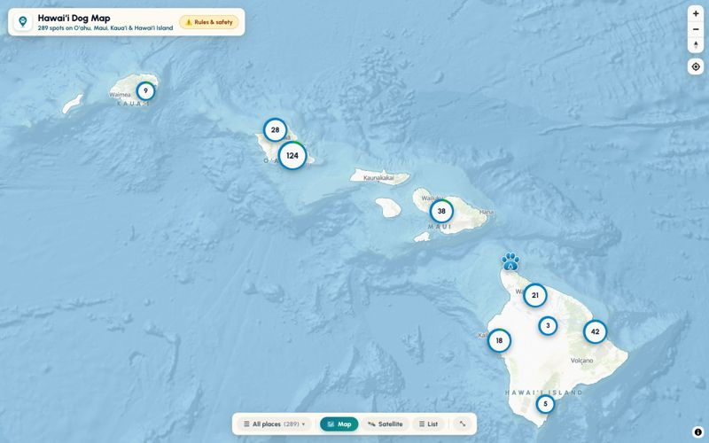
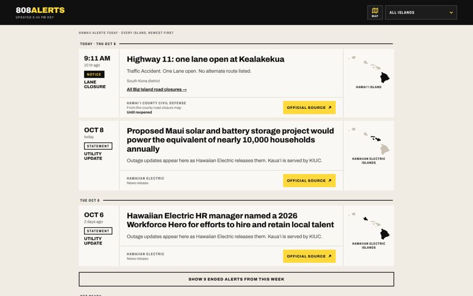
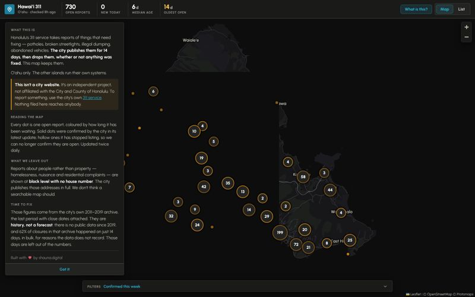
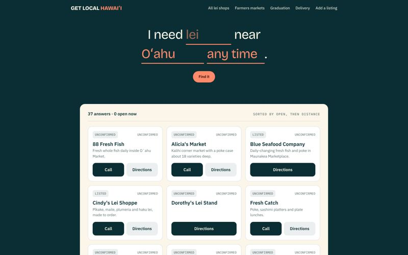
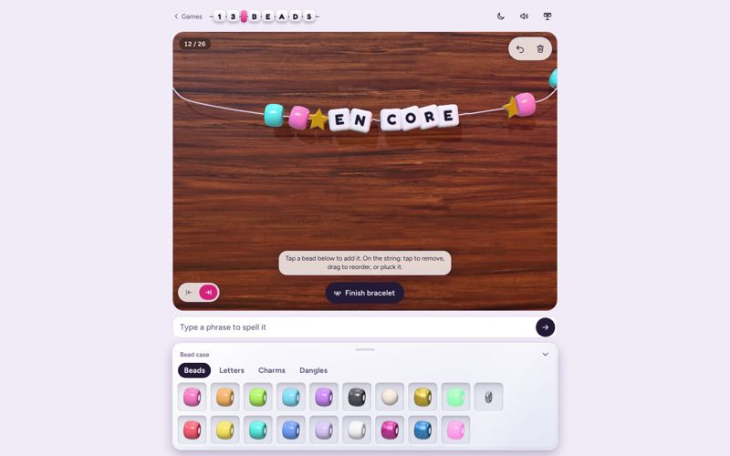
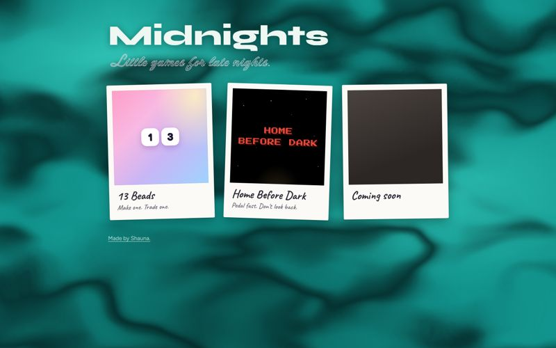

# Shauna Arnold

Designer and developer in Hawaiʻi. Websites, web apps, and AI tools for small businesses and
nonprofits, end to end: discovery, design, code, deployment, support.

**[shauna.digital](https://shauna.digital)** for client work · **[shauna.dev](https://shauna.dev)** for my portfolio

## Live projects

<table>
  <tr>
    <td width="50%" valign="top">
      
      <h3><a href="https://hawaiidogmap.com">Hawaiʻi Dog Map</a></h3>
      289 dog-friendly parks, beaches, trails and patios across four islands, each with its dog rules. 
      MapLibre GL · vanilla JS · <a href="https://github.com/shaunagits/hi-dog-maps">repo</a>
    </td>
    <td width="50%" valign="top">
      
      <h3><a href="https://808alerts.com">808 Alerts</a></h3>
      Official Hawaiʻi weather warnings, road closures, shelters and power updates in one feed. 
      Cloudflare Pages + Workers · vanilla JS · <a href="https://github.com/shaunagits/808alerts">repo</a>
    </td>
  </tr>
  <tr>
    <td width="50%" valign="top">
      
      <h3><a href="https://hawaii311.org">Oʻahu 311 Map</a></h3>
      A permanent archive of Honolulu 311 reports, which the city's own feed drops after 14 days, served as a live map. 
      Python · GitHub Actions · Leaflet · self-hosted vector tiles
    </td>
    <td width="50%" valign="top">
      
      <h3><a href="https://getlocalhawaii.com">Get Local Hawaiʻi</a></h3>
      Lei stands, fish and farmers markets on Oʻahu, with "open now" computed and every listing's last check shown. 
      Next.js · Supabase · <a href="https://github.com/shaunagits/getlocalhawaii">repo</a>
    </td>
  </tr>
  <tr>
    <td width="50%" valign="top">
      
      <h3><a href="https://games.shauna.digital/13-beads/">13 Beads</a></h3>
      String a friendship bracelet in 3D, spell a phrase, and hang it on your wall. 
      Three.js · Vite · <a href="https://github.com/shaunagits/13-beads">repo</a>
    </td>
    <td width="50%" valign="top">
      
      <h3><a href="https://games.shauna.digital">Games</a></h3>
      Little browser games for late nights. 
      Static site · <a href="https://github.com/shaunagits/games">repo</a>
    </td>
  </tr>
</table>

## Client work

Most client work lives in private repos, so this table is the index and the live links are the proof.

| Project | What it is | Stack | Where |
|---|---|---|---|
| **Gradient** | AI applicant tracking system for a tech recruiting firm. Sourcing, job-fit scoring, triage, AI-drafted outreach. In daily production use. | React · TypeScript · Supabase · Claude + OpenAI | Private |
| **Hānai** | Foster and adoption platform for a 501(c)(3) rescue. Intake, placement, medical records, messaging. 956 animals and 6,161 medical records migrated. | React · TypeScript · Supabase | Private |
| **Kahu** | Offline-first field operations app. GPS capture, photo upload, offline queue, PDF grant reporting. | React · TypeScript · Supabase | Private |
| **The Countdown Project** | Education-first site for a Hawaiʻi nonprofit ending dog overpopulation. Lighthouse 100 across the board. | Astro · Tailwind | [Repo](https://github.com/shaunagits/countdown-project) · [Live](https://countdownproject.org) |
| **Client portal** | Project status, tasks, files, and Stripe invoicing for my clients. | React · Vite · Supabase · Stripe | [Live](https://portal.shauna.digital) |
| **Vellum** | Premium Shopify Online Store 2.0 theme. 78 sections, 3 style presets, AA contrast. | Liquid · Shopify OS 2.0 | In development |

## Also on the bench

[Task Turtle](https://github.com/shaunagits/task-turtle), a calm, local-first task list, and static Astro rebuilds replacing aging WordPress installs.

---

[shauna.digital](https://shauna.digital) · [shauna.dev](https://shauna.dev) · [LinkedIn](https://www.linkedin.com/in/shaunaarnold/)
